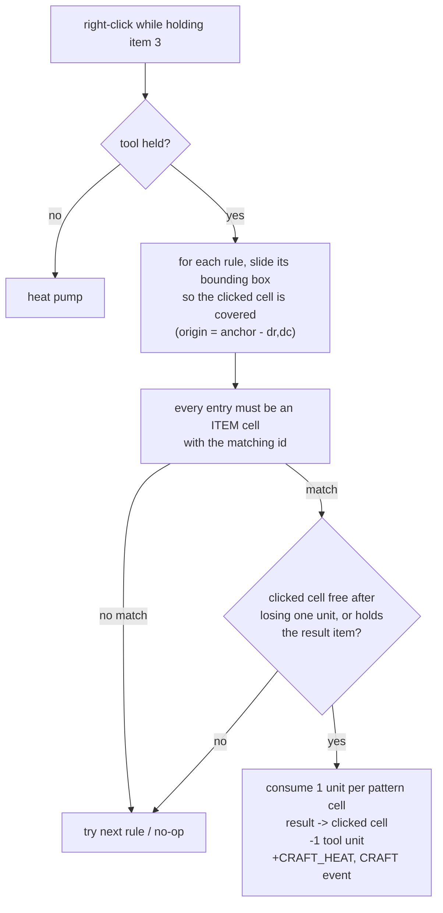

# Crafting — Design & Behaviour

Shaped, Minecraft-style recipes matched against a pattern of `ITEM` cells on the
board. Data lives in `assets/crafting.csv`; the model side is
`GameModel::tryCraftWithDrag()` (`src/game/model/game_model.cpp`).

## 1. The crafting element

Item id **3** (`assets/items.csv`, `CRAFT_TOOL_ITEM` in
`src/game/model/crafting.hpp`) is the crafting tool — a hammer. It is
deliberately **not** produced by the random world (`Config::numItems` stays 3),
so it has to be made in-game: `assets/reactions.csv` has a same-type rule
`wood + wood -> 1 wand`.

Hold it (drag state, picked up with the left button) and **right-click** a cell
that is part of a pattern. One tool unit is spent per craft.

> The right button is overloaded: **held tool → craft attempt**, otherwise it is
> the heat pump that drives quantum fluctuations (`docs/heat.md`). Nothing is
> held → heat. A craft attempt never falls through to heating.

## 2. Recipe format

```
resultId,resultCount,dr:dc:itemId,dr:dc:itemId,...
```

Each entry after the first two columns is one **(offset, item)** pair.
`dr` = rows down, `dc` = columns right, relative to the recipe's own origin, so
a recipe is authored the way it reads on the board:

```
# 1x3 — three wood in a row -> 2 stone
1,2,0:0:0,0:1:0,0:2:0

# L — wood + stone + water -> a crafting wand
3,1,0:0:0,1:0:1,0:1:2
```

Entries may be non-contiguous (L, T, ring, …). Extra fields can be appended
inside an entry after a further `:` (`dr:dc:itemId:count:…`) without a format
change — that is the extension point for per-entry requirements later.

Rules are tried **in file order**, so author specific shapes before general
ones. The bounding box is derived from the entries.

## 3. Matching



* **Patterns must fit inside one grid** (`GameModel::cellAtOffset` walks the
  parent grid only): a recipe cannot span a subgrid boundary.
* **Nothing is silently destroyed.** Every pattern cell loses exactly one unit,
  and the result lands on the *clicked* cell. If that cell still holds a
  different item after its unit is consumed, the craft is **refused** instead of
  overwriting it — split the pile first (or click a different pattern cell).
* The result *merges* into the clicked cell when it already holds the result
  item, keeping its leftover count.

## 4. Feedback

`CellEventType::CRAFT` → `EffectKind::CRAFT` → smoke puff, and
`Heat::CRAFT_HEAT` warms the cell the result lands on (a craft site gets hot, so
items around it keep acting).

## 5. Tests

`tests/test_crafting.csv` (+ fixture `tests/crafting.csv`) covers: no tool held →
no-op, a successful L craft (pattern consumed, result placed, tool spent), and a
repeat craft on a consumed pattern matching nothing. The harness drives it with
the `craft,row,col` step.
