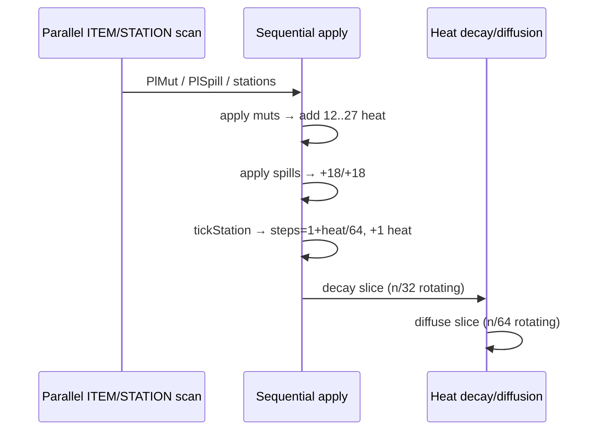
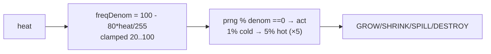
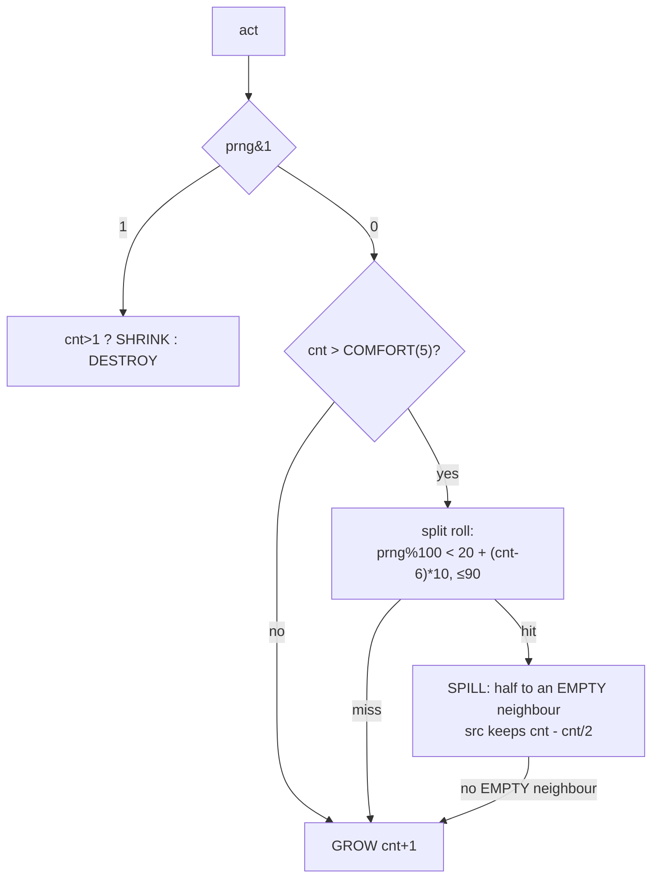
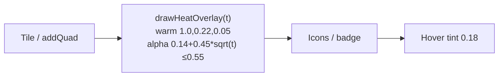
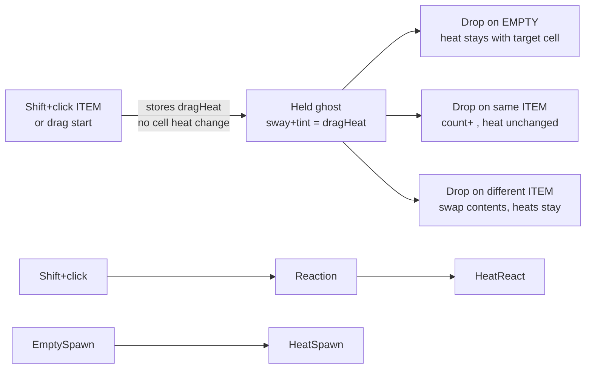

# Heat — Design & Behaviour

> Single `unsigned char` (0-255) per **non-composite** cell (`EMPTY`, `ITEM`, `STATION`, `RESERVED`). `GRID` is composite and carries no heat.

## 1. Storage

`heat` is a `uint8_t` member of `Cell`; `sizeof(Cell)` is 20 bytes (12-byte payload union plus `parentId`/`heat`, tail padding included). The cell's type is **not** stored in the cell — it lives in the parallel `GameModel::_type` byte map that the tick plan phase prescans (see `AGENTS.md`). `GRID` entries ignore `heat` (padding).

API in `GameModel` (`src/game/model/game_model.hpp:74` / `.cpp:504`):

```cpp
uint8_t heatAt(int idx) const;
void setHeat(int idx, uint8_t h);
void addHeat(int idx, int delta); // clamped 0..255, no-op for GRID
uint8_t dragHeat() const;         // visual only while held
```

Dragging preserves the source's heat in `GameModel::_dragHeat` for sway tint while held, **but does not transfer it** on `drop()` — heat stays with the **cell**, not the item (`b287db7`, heat-neutral pick/drop).

---

## 2. Lifecycle — Generation, Decay, Diffusion

```mermaid
flowchart TB
    subgraph Sources["Heat sources (+Δ)"]
        A[Random warm seed<br/>2% cells 80..200<br/>initRandomGrid]
        B[ITEM tick mut<br/>GROW/SHRINK/DESTROY<br/>+12 + (255-heat)>>4 self-limiting]
        C[Spill<br/>src+18 / tgt+18]
        D[Interact reaction<br/>a+18 / b+12<br/>fallback cycle +6]
        E[Empty spawn<br/>+10]
        F[Station I/O<br/>RESERVED +8 / anchor +4<br/>tick working +1]
        G[Station progress active<br/>+1 per tick]
        Q[RMB hold on cell<br/>+6 per sim tick<br/>Game::step → hovered cell]
    end
    Sources --> H{Cell.heat 0..255}
    H --> I[Decay<br/>-(heat>>3 +1) every 32 ticks/cell<br/>1/32-array slice each tick]
    I -.->|EMPTY ≥ 200: 25% roll| QS[Quantum fluctuation<br/>random ITEM ×1, heat→0]
    H --> J[Diffusion<br/>~1/128 hot cells/64 ticks/cell<br/>1/64-array slice each tick<br/>-1 here +1 random neighbour (4-dir)]
    I --> H
    J --> H
```

### Tick integration (`GameModel::tick()` — `src/game/model/game_model.cpp:260`)



* **Decay** was O(n) with heavy `prng()`+`findSpillTarget()` → ~1000× slowdown, replaced with cheap sampled sibling-only loops.
* Diffusion uses cheap LCG: `r = i*1103515245 + tick*134775813`, target = the precomputed adjacency neighbour in direction `r & 3` (`_adj` table, may cross subgrid boundaries).

---

## 3. Gameplay Effect — Reactiveness

### ITEM (`src/game/model/item_cell.cpp:71`)



```cpp
int heat = cell.heat;
int freqDenom = 100 - (heat * 80 / 255); // 100→20
if (freqDenom < 20) freqDenom = 20;
if (freqDenom > 100) freqDenom = 100;
if (prng(idx,0) % freqDenom != 0) return;
```

Once it acts, `prng(idx,1) & 1` picks the branch:



**Growth is uncapped** (uint16 ceiling only) and a **spill is a proportional
split**, not a fixed transfer — the old code wrote `src=tgt=3`, which silently
destroyed 44 units out of a 50-stack and hard-capped growth at 5. A tall pile
now drains in ~log₂ steps: 12 → 6+6 → … The split chance rises with the stack
(`Heat::ITEM_SPILL_CHANCE_*`), so piles settle in the high single digits
instead of running away. Target choice stays `findSpillTarget` (random EMPTY
neighbour via `prng(idx,2)`); with nowhere to spill, the stack keeps growing
rather than stalling.

> **Feature flags — off by default.** All three automatic behaviours above are
> gated by `Config::itemGrow` / `itemShrink` / `itemSplit` (CLI:
> `--item-dynamics`, or individually `--item-grow` / `--item-shrink` /
> `--item-split`). Out of the box the board only changes when the player acts
> (craft, react, merge, drop, heat): the code paths stay intact, the flags just
> gate them. Disabling them also removes most of the tick cost (apply phase →
> ~0 ms, events/tick ~54k → ~4 on an 11.5M-node world). The recipe book's
> Stacking tab greys the disabled rows and labels them `off`.

### STATION (`src/game/model/station_cell.cpp:10`)

```cpp
int steps = 1 + heat/64; // 1..4 (255→4)
st.progress -= steps;
```

Higher heat → faster crafting. `EMPTY`/`RESERVED` have no autonomous tick, but their heat tints the background and will affect future `ITEM` ticks if they become items.

---

## 4. Visuals

### 4.1 Background tint (`src/game/view/cell_renderer.cpp:21`)

All non-GRID cells draw a warm rounded-rect overlay **after** the tile/`addQuad` background but **before** icons, so the tint is cell-local and never obscures the item.



* `t = heat/255`. `alpha = 0.14 + 0.45*sqrt(t)` — even `heat=10` → `alpha≈0.23` visible. Capped `0.55`.
* Drawn as `SkRRect` radius `w*10/64`, `SkPaint rgba(warm, alpha)`.

```
heat 0   → no overlay
heat 10  → faint orange wash
heat 100 → distinct warm tint
heat 255 → strong 0.55 wash
```

### 4.2 Sway (`src/game/view/icon_renderer.cpp:28`, `src/game/view/per_path_svg.cpp:239`)

```mermaid
flowchart TB
    subgraph Base["getRotationAngle(node, id, inst, t, hovered, heat)"]
        s[seed = node*73856093 ^ id*83492791 ^ inst*2654435761 ^ hoverXor]
        amp[amp 6..12 * (1+0.7*t)]
        freq[freq 0.3..0.4 * (1+0.9*t)]
    end
    subgraph PerPath["perPathSwayAngle(path, seed, heat)"]
        pf[freq 0.35..0.91 * (1+0.9*t)]
        pa[amp 4..8.8 * (1+0.7*t)]
        tr[transAmp 1.5 * (1+0.6*t)<br/>transFreq 0.5..0.95 * (1+0.6*t)]
    end
    heat --> Base
    heat --> PerPath
```

* `t = heat/255`, `heat` fetched from `view.model.node(nodeIndex).heat` (or `dragHeat` while held). Seed remains **nodeIndex-based** (stable across pan/anchor/mouse moves).
* Effect: hot items flutter faster/wider — up to ~1.9× freq, +70% amp.

---

## 5. Interaction Map



All `addHeat` call sites:

| Call site | File | Δ |
|---|---|---|
| `ItemCell::collectTickPlan` mut | `item_cell.cpp:80` | +12..27 |
| `ItemCell` spill | `game_model.cpp:342` | +18 / +18 |
| `ItemCell::interact` reaction | `item_cell.cpp:127` | +18 / +12, cycle +6 |
| `EmptyCell::interact` spawn | `empty_cell.cpp:13` | +10 |
| `StationCell::tick` working | `station_cell.cpp:16` | +1 |
| `StationCell/ReservedCell` I/O | `station_cell.cpp:126`, `reserved_cell.cpp:18` | +8 / +4 |
| RMB hold ("heat a cell") | `game.cpp` `Game::step` | +6 per sim tick into the hovered cell |

Pick/drop intentionally **heat-neutral** (cell-local invariant).

### Quantum fluctuation — superheated vacuum births particles

The entry point for an empty board: hold **right mouse button** over any
non-GRID cell and heat pumps in (`Heat::QUANTUM_HOLD_HEAT_PER_TICK`/tick,
~2 s to saturation). Once an **EMPTY** cell sits at ≥ `QUANTUM_MIN_HEAT`
(200), every heat-decay pass visits it (≈1.6 s at 20 tps) with a
`QUANTUM_CHANCE_PCT` (25%) roll (`GameModel::quantumFluctuation`, called
from the decay slice — no extra scan). A hit materialises a random item
(uniform over `_numItems`) as `ITEM ×1` and the fluctuation **absorbs the
cell's energy**: heat drops to 0, doubling as birth signature and
cooldown. Emits `CellEventType::QUANTUM_SPAWN` → `EffectKind::QUANTUM_SPAWN`
smoke burst. Rolls go through `GameModel::prng(idx, salt)`, so
`test_rng`-forced CSV scenarios stay deterministic
(`tests/test_quantum.csv`).

---

## 6. Tuning Knobs

* **Visibility**: overlay `0.14+0.45*sqrt(t)`, seeding 2% warm cells. Raise base or lower `sqrt` exponent for subtler effect.
* **Reactivity**: change `80` in `100-80*t` or clamp `20` for aggressiveness; `heat/64` for station steps.
* **Persistence**: per-cell periods stay 32/64 ticks, but both passes run as rotating
  array slices every tick (amortized — no full-array scan storm).
* **Balance**: mut gain is *inverted* in heat (`+12 + (255-heat)>>4`) and decay is
  proportional (`heat>>3 + 1`), so activity↔heat has a fixed point (~60-80 steady).
  Constant gain + fixed −1 decay was a runaway: events/tick doubled in ~2 min on big
  boards and fps decayed with them (2025-09 incident).
* **Sway**: multipliers `0.7` (amp) / `0.9` (freq) — reduce for calmer hot items.
* **Quantum**: hold rate `QUANTUM_HOLD_HEAT_PER_TICK` (feel), threshold
  `QUANTUM_MIN_HEAT` (vs decay equilibrium ~222: must stay reachable), roll
  `QUANTUM_CHANCE_PCT` per decay pass (~6 s of holding is one expected birth).
* **Growth/split**: `ITEM_SPILL_COMFORT` sets when piles start splitting;
  `ITEM_SPILL_CHANCE_BASE`/`_PER`/`_MAX` set how eagerly (higher = flatter
  piles). A split always moves half, so `_MAX` is the real runaway brake.

See `PERF.md` for tick cost: diffusion now ~0.7M checks/tick avg vs. 11M heavy before.

---

## 7. Balancing Constants (`src/game/heat_constants.hpp`)

All tunables live in one header — edit, rebuild, no hunt for magic numbers.

```cpp
// src/game/heat_constants.hpp
namespace Heat {
  // Seeding
  INIT_WARM_CHANCE_PCT = 2; INIT_WARM_MIN = 80; INIT_WARM_MAX = 200;
  // ITEM reactiveness
  ITEM_FREQ_BASE=100, ITEM_FREQ_RANGE=80, ITEM_FREQ_MIN=20, ITEM_FREQ_MAX=100;
  ITEM_MUT_BASE=12, ITEM_MUT_SCALE_SHIFT=4; // + (heat>>4) → 12..27
  // Spill / interactions
  SPILL_HEAT_SRC=18, SPILL_HEAT_TGT=18;
  INTERACT_REACTION_A=18, INTERACT_REACTION_B=12, INTERACT_CYCLE=6;
  EMPTY_SPAWN_HEAT=10;
  // Station / Reserved
  STATION_INPUT_HEAT=8, STATION_ANCHOR_HEAT=4, STATION_TICK_SELF_HEAT=1;
  STATION_STEP_DIV=64; // steps=1+heat/64
  RESERVED_BUFFER_HEAT_IN=5, RESERVED_BUFFER_HEAT_OUT=2;
  // Decay / diffusion (masks: interval = mask+1)
  DECAY_PERIOD_MASK=31;       // every 32 ticks
  DIFFUSION_PERIOD_MASK=63;   // every 64 ticks
  DIFFUSION_SPARSE_MASK=127;  // ~1/128
  namespace Visual {
    ALPHA_BASE=0.14, ALPHA_SCALE=0.45, ALPHA_CAP=0.55;
    WARM_R=1.0, WARM_G=0.22, WARM_B=0.05;
    SWAY_AMP_SCALE=0.7, SWAY_FREQ_SCALE=0.9;
    TRANS_AMP_SCALE=0.6, TRANS_FREQ_SCALE=0.6;
  }
}
```

### How to balance

| Goal | Knob | Effect |
|---|---|---|
| Hot cells too rare / invisible | ↑ `INIT_WARM_CHANCE_PCT`, ↓ `INIT_WARM_MIN`, ↑ `Visual::ALPHA_BASE/SCALE` | More starting heat, stronger tint |
| Game too frantic when hot | ↑ `ITEM_FREQ_MIN` (e.g. 30) or ↓ `ITEM_FREQ_RANGE` (e.g. 60) | Caps max tick rate |
| Heat fizzles instantly | ↑ `DECAY_PERIOD_MASK` (e.g. 63 → 64 ticks) or ↓ `ITEM_MUT_BASE` | Slower cooling / less feedback |
| Heat lingers forever | ↓ `DECAY_PERIOD_MASK` (e.g. 15 → 16 ticks) or ↓ `DIFFUSION_PERIOD_MASK` | Faster cooling / spread |
| Station too slow/fast | `STATION_STEP_DIV` (smaller → more steps) | 32 → hot 1..8 steps, 128 → 1..3 |
| Sway too wild/calm | `Visual::SWAY_*_SCALE` | 0.0 → no heat sway, 1.0 → double at max |

**Workflow**: tweak `src/game/heat_constants.hpp` → `cmake --build build -j` → `./build/fractory --tick 20` (check `avg ms/tick`) and visual check of tint/sway. No other files need edits.
