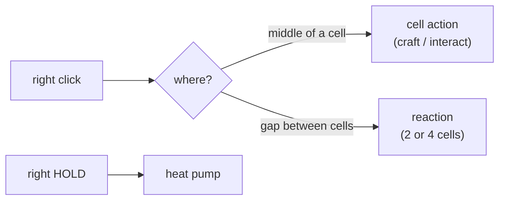

# Reactions — Design & Behaviour

Combining items by clicking the **space between them**, rather than clicking an
item and hoping its neighbour is the right one. Data lives in
`assets/reactions.csv`; the model side is `GameModel::tryReaction()`
(`src/game/model/game_model.cpp`), the cursor side is `GameView::resolveGap()`
(`src/game/view/game_view.cpp` + `PickingEngine::resolveLeafCell`).

## 1. The gesture

Right-click in the **gap**:

* an **edge** gap — the space between two cells sharing an edge → those 2 cells;
* a **corner** gap — the space where a 2×2 block of cells meets → those 4 cells.

A gap click never falls back to a cell action: if nothing matches, nothing
happens. A click in the *middle* of a cell is a cell action instead (craft with
the wand held, otherwise the plain interact), so the two gestures are disjoint.



`GameView::resolveGap()` decides by the point's position inside the nearest cell
(`u`,`v` in cell units, ±0.5 being the cell's own edges — the gutter itself is
past ±0.5, so the visual gap is included by construction):

| zone | share of a cell | meaning |
|---|---|---|
| `max(|u|,|v|) < 0.26` | ~27% | the middle → a cell action |
| one axis past `0.38` | ~25% | an edge gap (left/right/up/down) |
| both axes past `0.26` | ~23% | a corner gap (ul/ur/dl/dr) |
| the rest | ~25% | ambiguous → treated as the middle |

The corner band is wider than the edge band on purpose: an edge target is a long
strip, a corner target a small square. Both are comfortably wider than the
visible gutter (`GameView::_gapRatio` ≈ 7%), which would otherwise be a one-pixel
target at normal zoom.

## 2. Rules are ingredient sets, not shapes

```
resultId,resultCount,itemId:count,itemId:count[,...]
```

A rule carries **2 to 4 ingredients**. Each ingredient names an item id and the
**exact stack count** its cell must hold. Matching is a multiset comparison over
the ITEM cells the gap touches:

* **arrangement is irrelevant** — a rule is a set, so the same three items react
  whether they sit in an L, a row, or any other corner arrangement;
* **counts are exact** — a rule wanting `wood:2` does not fire on a stack of 3,
  and a rule wanting `wood:1 + wood:1` needs *two separate* cells, not one pile
  of two;
* **size is exact** — the number of ingredients must equal the number of ITEM
  cells in the gap. A corner with 3 filled cells and 1 empty one tries the
  3-ingredient rules only; fill the 4th and it tries the 4-ingredient ones;
* EMPTY cells contribute nothing and are simply not part of the set;
* a non-ITEM, non-EMPTY cell in the gap (a machine or one of its reserved tiles)
  aborts the whole attempt.

Rules are tried in file order, so author specific sets before general ones.

## 3. Same subgrid only

Every cell of the gap must live in the **same grid**. This is enforced by
`GameModel::cellAtOffset()`, which walks the parent grid and returns -1 for any
offset that leaves it — so a gap that would reach across a subgrid edge simply
cannot match. A gap on the outer border of a grid is likewise inert.

## 4. The result goes into your hand

On a match every ingredient cell is emptied (the counts matched exactly, so each
stack is consumed whole) and the result is placed in the **drag state** — the
player ends the reaction *holding* it, free to drop it anywhere. The drag's
source cell is the gap's first cell (now empty), so cancelling the drag simply
puts the result back where the reaction happened.

The hand must be **free**: a reaction with a stack already held is refused
(there would be nowhere for the result to go), and nothing is consumed.

Feedback: `CellEventType::REACTION` → `EffectKind::INTERACT_REACTION` → smoke, the
gap's cells are heated (`Heat::INTERACT_REACTION_A` on the first,
`_B` on the rest), and the recipe book marks the rule as performed.

## 5. Cells still interact on their own

Reactions moved off `ItemCell::interact`, so right-clicking an item cell no
longer combines it with a neighbour. What remains there is the manual fallback —
stepping the item id on (`(id + 1) % numItems`) — plus machine loading and the
spawn-on-empty-cell rule.

## 6. Tests

`tests/test_reaction_gap.csv` (+ fixture `tests/reactions.csv`) covers: a gap on
the grid border (inert), an exact-count mismatch (nothing consumed), an edge gap
that reacts (cells emptied, result held), a busy hand (refused), a 3-ingredient
corner with the 4th cell empty, and a 4-ingredient corner that must *not* match
the 3-ingredient rule. The harness drives it with the `react,row,col,side` step
(`side` = `up`/`down`/`left`/`right` for an edge, `ul`/`ur`/`dl`/`dr` for a
corner). `tests/test_reaction_wand.csv` covers the wand bootstrap,
`tests/test_interact_cycle.csv` the id-cycle fallback.
